Inspired by [LeakCanary](https://square.github.io/leakcanary/).

Automatic memory-leak detection for Flutter.

LeakSentry watches the objects Flutter disposes and tells you which ones something is still holding on to. When it can reach the app's VM service, it also shows what is holding them.

<p align="center">
  <a href="doc/how-it-works.mp4">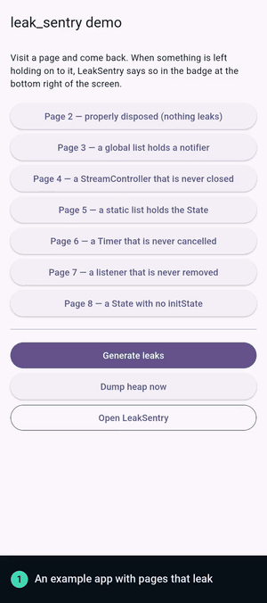</a>
  <br>
  <sub>The example app, in about 35 seconds. <a href="doc/how-it-works.mp4">Watch it as a video.</a></sub>
</p>

1. **Watch.** When Flutter disposes a `State`, a `Route`, a `ChangeNotifier` or an `AnimationController`, LeakSentry expects it to be garbage collected, and holds a weak reference to it.
2. **Wait five seconds.** If the weak reference hasn't been cleared by then, the object is *retained*. Nothing has forced a GC yet, so this is provisional.
3. **Check.** A retained object schedules a check. It forces a GC (unless the last one already covered every retained object), counts again, and then decides: while the app is visible it waits for **5** retained objects (and rechecks every 2 s); once the app has been in the background for a few seconds it dumps for any number. On its own it never dumps more than once a minute; a scan you ask for is not held back.
4. **Dump and analyze.** The retained objects are captured, the VM is asked for the retaining path of each distinct leak, and the leaks are reported. An object that was reported is never reported again.

A resource that never gets a disposal callback, a `StreamController` for one, is not watched automatically. Swap in `TrackedStreamController`, or pass the resource to `LeakSentry.trackResource`, and a second detection [reports it if it is garbage collected without being closed](#detecting-unclosed-resources).

## See it work

The screens below are from an example app with six pages that leak and one that does not. LeakSentry is installed in it with one line at startup (in debug builds), and its overlay sits above the app's navigator: see [Getting started](#getting-started) and [Seeing leaks in the app](#seeing-leaks-in-the-app) to do the same in yours.

### Before anything leaks

<table>
  <tr>
    <td align="center" valign="top" width="33%">
      <a href="doc/screenshots/01_example_app.png">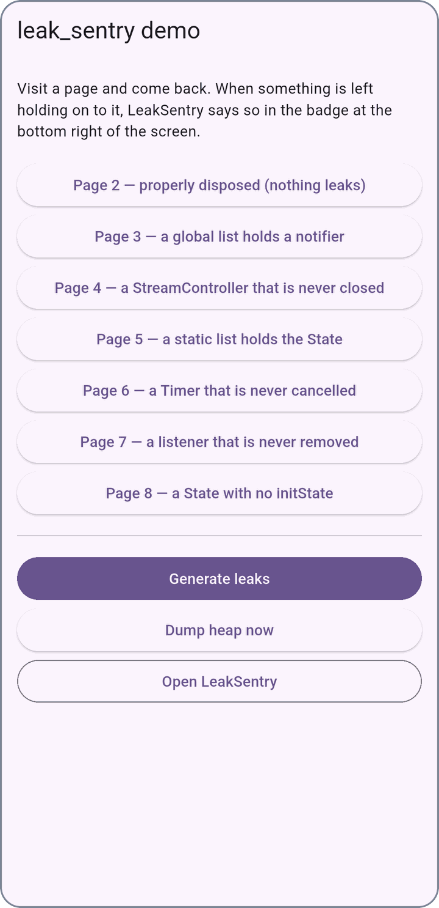</a><br>
      <b>The example app</b><br>
      <sub>Six pages that leak, and one that does not. LeakSentry shows nothing until it has something to say.</sub>
    </td>
    <td align="center" valign="top" width="33%">
      <a href="doc/screenshots/02_leaks_empty.png">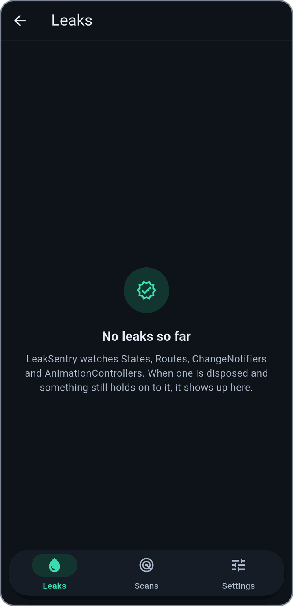</a><br>
      <b>The Leaks tab, empty</b><br>
      <sub>The example app has a button that opens LeakSentry&#39;s screen. Nothing has leaked yet.</sub>
    </td>
    <td align="center" valign="top" width="33%">
      <a href="doc/screenshots/03_scans_empty.png">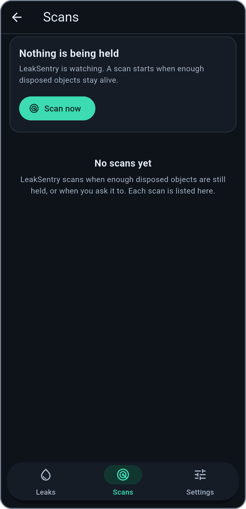</a><br>
      <b>The Scans tab, empty</b><br>
      <sub>Nothing is held and nothing was scanned. Scan now scans whatever is held, at once.</sub>
    </td>
  </tr>
</table>

### A page leaks, and LeakSentry notices

Visit a page and come back: steps 1 and 2 above. Flutter disposes the page, and LeakSentry expects what belongs to it to be garbage collected. Five seconds later, if it is not, it is *retained*; LeakSentry checks it by forcing a garbage collection, and what is still there is *held*, the word the screens use.

<table>
  <tr>
    <td align="center" valign="top" width="33%">
      <a href="doc/screenshots/04_leaky_page.png">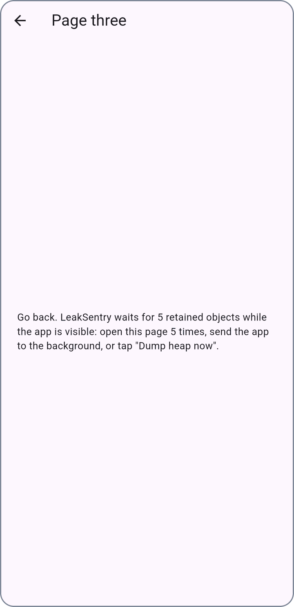</a><br>
      <b>A page that leaks</b><br>
      <sub>Page 3 keeps a notifier in a global list that nothing empties, and the notifier is disposed with the page.</sub>
    </td>
    <td align="center" valign="top" width="33%">
      <a href="doc/screenshots/05_notice.png">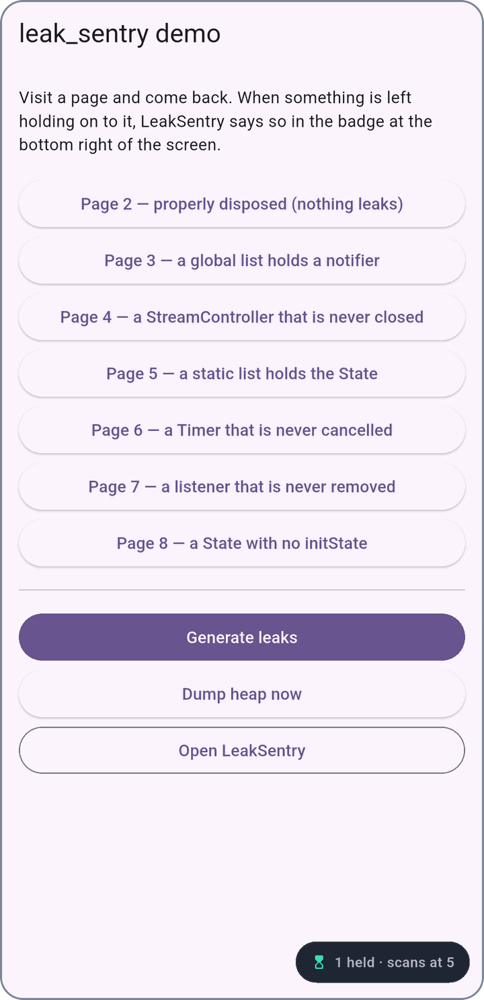</a><br>
      <b>The notice</b><br>
      <sub>Five seconds after the page is gone, the notifier is still reachable. The notice says one object is held, and that LeakSentry scans when 5 are.</sub>
    </td>
    <td align="center" valign="top" width="33%">
      <a href="doc/screenshots/06_scans_held.png">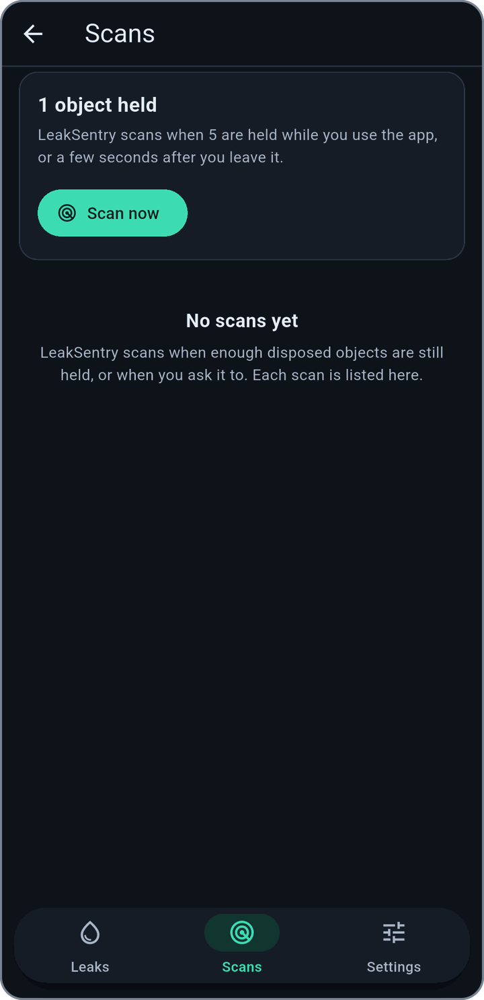</a><br>
      <b>Why it has not scanned yet</b><br>
      <sub>Tap the notice to open the Scans tab: LeakSentry scans when 5 are held while you use the app, or a few seconds after you leave it.</sub>
    </td>
  </tr>
</table>

### A scan finds the leaks

Scanning is steps 3 and 4 above: a garbage collection, then a path for each distinct leak.

<table>
  <tr>
    <td align="center" valign="top" width="33%">
      <a href="doc/screenshots/07_scanning.png">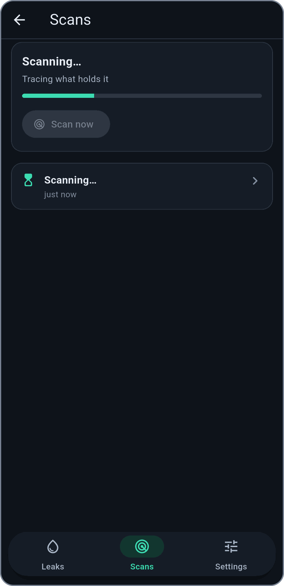</a><br>
      <b>A scan under way</b><br>
      <sub>A scan forces a garbage collection, then asks the VM what holds each leak. Paused at its second step for this screenshot.</sub>
    </td>
    <td align="center" valign="top" width="33%">
      <a href="doc/screenshots/08_badge.png">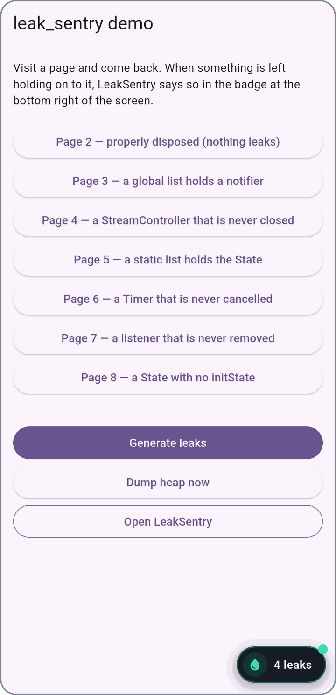</a><br>
      <b>The badge</b><br>
      <sub>A scan that finds leaks puts a badge on the app with how many. The dot is there while a leak has not been opened.</sub>
    </td>
    <td align="center" valign="top" width="33%">
      <a href="doc/screenshots/09_leaks.png">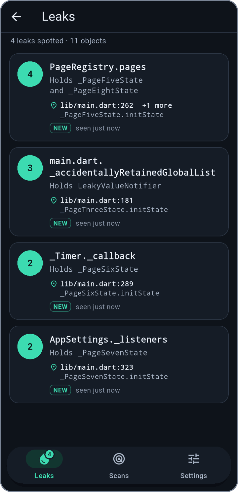</a><br>
      <b>The Leaks tab</b><br>
      <sub>One card for each distinct leak, the one with the most objects first: how many objects, what holds them, and where the latest of them was created. <i>NEW</i> marks a leak you have not opened yet.</sub>
    </td>
  </tr>
</table>

### One leak, in detail

Tap a leak. The first card says where the object was created, the file and line, or why that is not known. The second says what is holding it. Here a `Timer` that is never cancelled holds a closure that captured the page's `State`.

<table>
  <tr>
    <td align="center" valign="top" width="33%">
      <a href="doc/screenshots/10_leak_timer_top.png">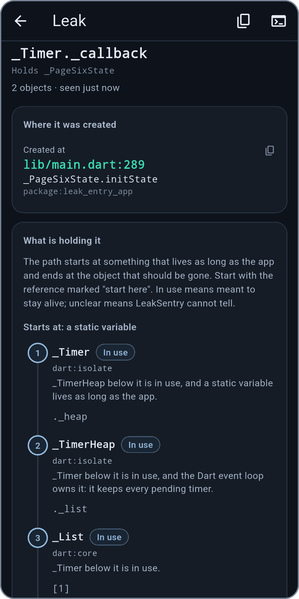</a><br>
      <b>Where it was created</b><br>
      <sub>The file and line, and the start of the path that holds the leak.</sub>
    </td>
    <td align="center" valign="top" width="33%">
      <a href="doc/screenshots/11_leak_timer_path.png">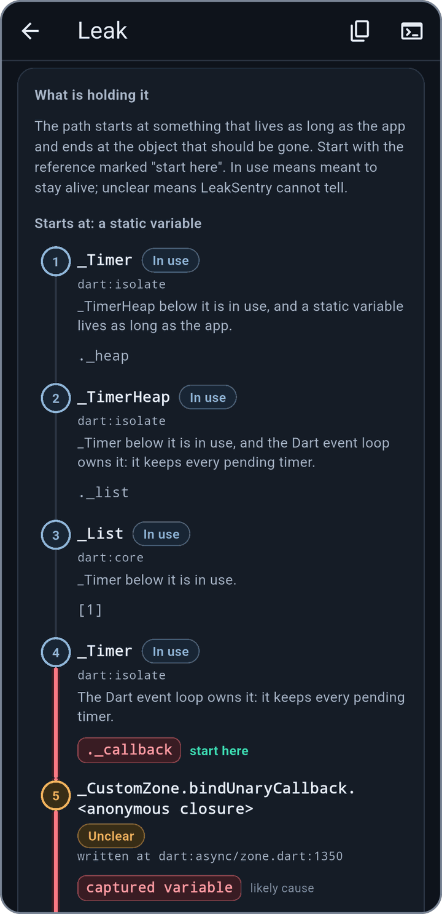</a><br>
      <b>What is holding it</b><br>
      <sub>The path from something that lives as long as the app, step by step. <i>start here</i> marks the reference to look at first.</sub>
    </td>
    <td align="center" valign="top" width="33%">
      <a href="doc/screenshots/12_leak_timer_path_end.png">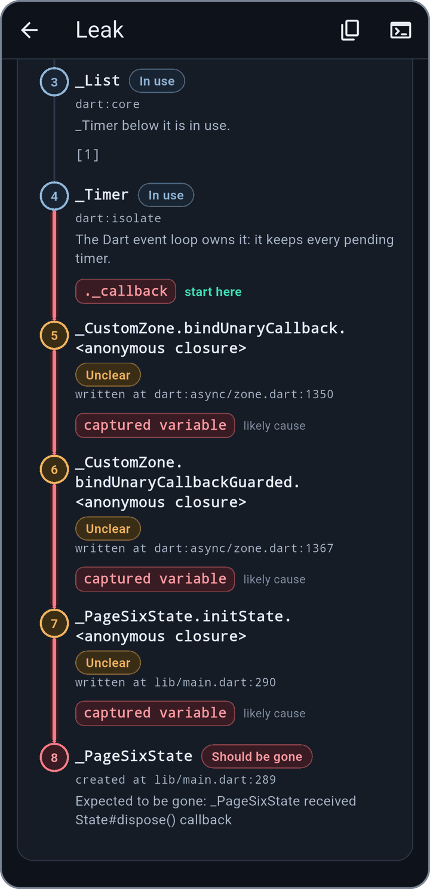</a><br>
      <b>The leaked object</b><br>
      <sub>The path ends at the object Flutter said was disposed. Steps LeakSentry cannot judge are <i>unclear</i>; likely causes are marked.</sub>
    </td>
  </tr>
</table>

**Copy report** and **Print to console**, the two icons at the top of the leak, give the leak as plain text, to paste into an issue.

<details>
<summary>The report of this leak</summary>

```text
LeakSentry report
_Timer._callback · 2 objects · last seen just now
Holds _PageSixState

Created at: package:leak_entry_app/main.dart:289:11
  _PageSixState.initState
Path (from the root to the leaked object)
  Starts at: a static variable
  1. _Timer ._heap [in use]
     _TimerHeap below it is in use, and a static variable lives as long as the app.
  2. _TimerHeap ._list [in use]
     _Timer below it is in use, and the Dart event loop owns it: it keeps every pending timer.
  3. _List [1] [in use]
     _Timer below it is in use.
  4. _Timer ._callback [in use] <- likely cause
     The Dart event loop owns it: it keeps every pending timer.
  5. _CustomZone.bindUnaryCallback.<anonymous closure> captured variable [unclear] <- likely cause
  6. _CustomZone.bindUnaryCallbackGuarded.<anonymous closure> captured variable [unclear] <- likely cause
  7. _PageSixState.initState.<anonymous closure> captured variable [unclear] <- likely cause
  8. _PageSixState [should be gone] (the leaked object)
     Expected to be gone: _PageSixState received State#dispose() callback
```

</details>

Two more kinds of leak look different:

<table>
  <tr>
    <td align="center" valign="top" width="33%">
      <a href="doc/screenshots/13_leak_registry.png">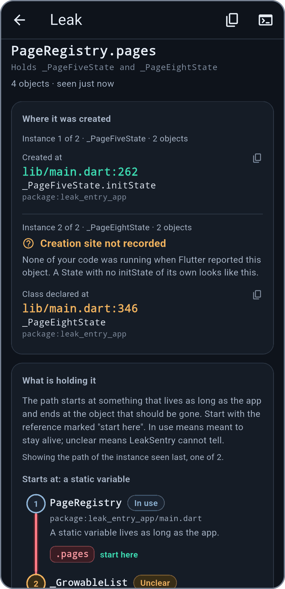</a><br>
      <b>Several objects, one leak</b><br>
      <sub>Two kinds of State held by one static list are one leak. The one with no <code>initState</code> has no creation site to show, so it says why, and where its class is declared.</sub>
    </td>
    <td align="center" valign="top" width="33%">
      <a href="doc/screenshots/14_leaks_resources.png">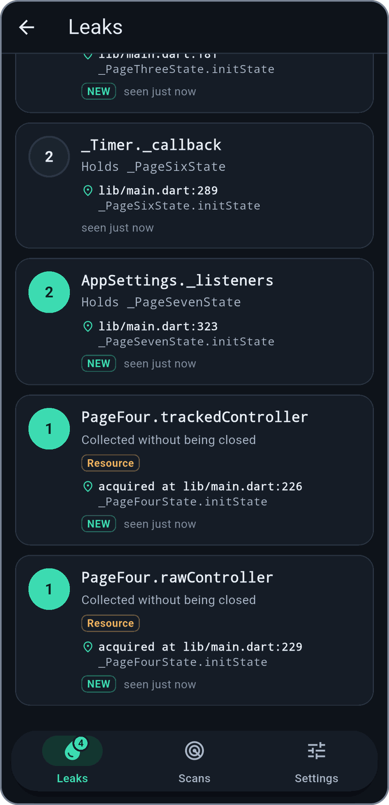</a><br>
      <b>A resource never closed</b><br>
      <sub>A <code>TrackedStreamController</code> that was never closed is reported when it is garbage collected.</sub>
    </td>
    <td align="center" valign="top" width="33%">
      <a href="doc/screenshots/15_resource_leak.png">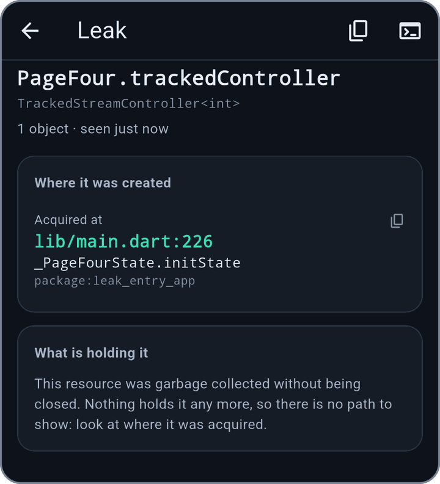</a><br>
      <b>Where it was acquired</b><br>
      <sub>Nothing holds it any more, so there is no path. The leak says where the resource was acquired instead.</sub>
    </td>
  </tr>
</table>

### Scans and settings

<table>
  <tr>
    <td align="center" valign="top" width="25%">
      <a href="doc/screenshots/16_scans.png">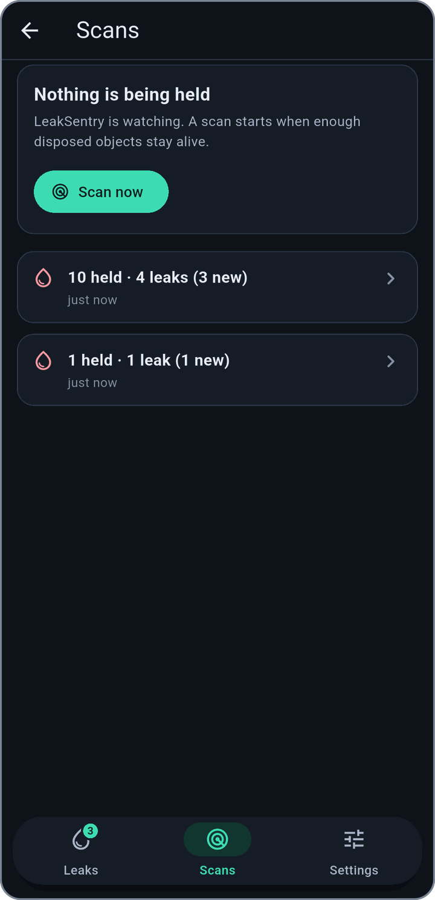</a><br>
      <b>The scans</b><br>
      <sub>The latest scans, newest first. Scan now scans whatever is held.</sub>
    </td>
    <td align="center" valign="top" width="25%">
      <a href="doc/screenshots/17_scan.png">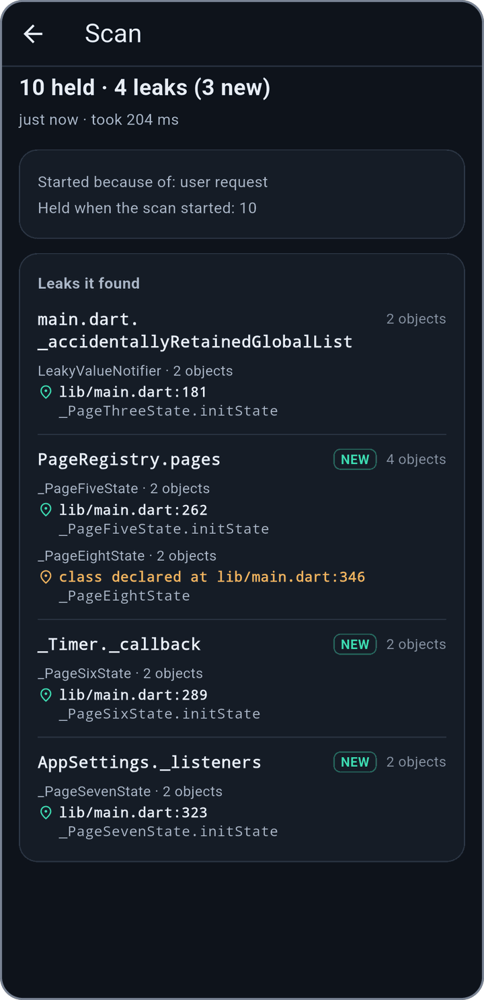</a><br>
      <b>One scan</b><br>
      <sub>Why it started, how many objects were held, how long its analysis took, and the leaks it found. <i>NEW</i> marks a leak that no earlier scan had found.</sub>
    </td>
    <td align="center" valign="top" width="25%">
      <a href="doc/screenshots/18_settings.png">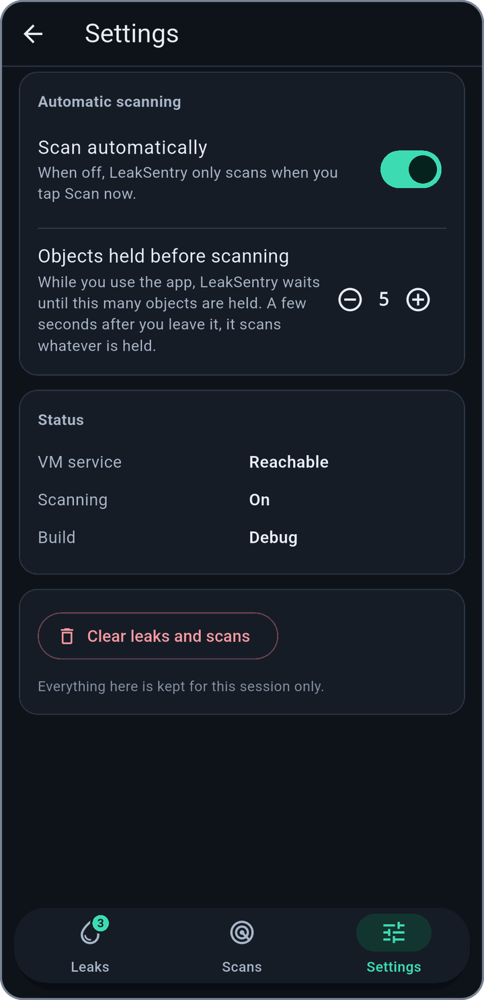</a><br>
      <b>Settings</b><br>
      <sub>Whether to scan automatically, how many held objects to wait for, and whether the VM service can be reached.</sub>
    </td>
    <td align="center" valign="top" width="25%">
      <a href="doc/screenshots/19_clear.png">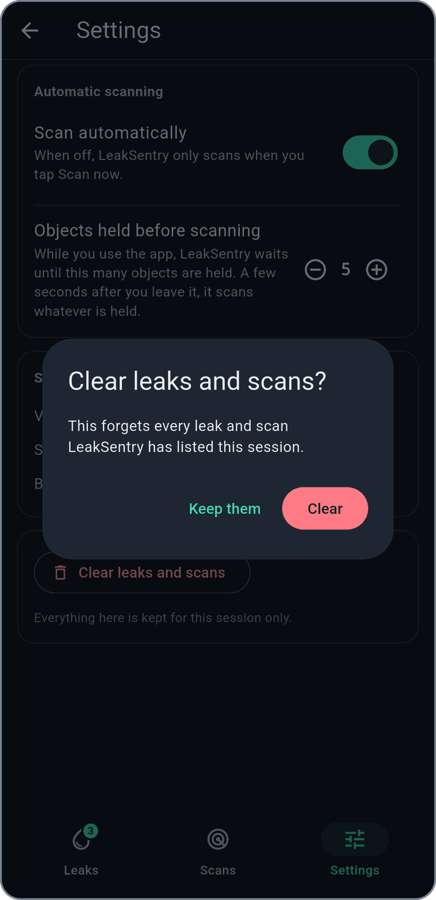</a><br>
      <b>Clear</b><br>
      <sub>Forgets the leaks and scans of this session, and asks first.</sub>
    </td>
  </tr>
</table>

## Getting started

Call `install` once at startup, after the bindings are initialized:

```dart
import 'package:flutter/foundation.dart';
import 'package:flutter/widgets.dart';
import 'package:leak_sentry/leak_sentry.dart';

void main() {
  WidgetsFlutterBinding.ensureInitialized();
  if (!kReleaseMode) LeakSentry.install();
  runApp(const MyApp());
}
```

Or wrap your app root in the `LeakSentry` widget, which installs it for you (outside of release builds, and outside of `flutter test`):

```dart
LeakSentry(child: MaterialApp(home: const HomePage()))
```

Add `LeakSentryOverlay` inside it to see leaks in the running app, as [described below](#seeing-leaks-in-the-app).

`install` throws in a release build: a heap dump freezes the app, and a release build has no VM service to analyze it with. If you really want it there, pass `allowInRelease: true`. To only *count* retained objects in release builds, without ever dumping the heap, call `LeakSentry.installObjectWatcher()` and read `LeakSentry.retainedObjectCount`.

### What is watched

Flutter reports object creation and disposal, from inside an `assert`, in **debug builds only**. In a debug build LeakSentry watches:

| Object | Expected to be collected after | Notes |
| --- | --- | --- |
| `State` | `State.dispose()` | The creation site is the `initState` of the leaking `State`. |
| `Route` | `Route.dispose()` | |
| `ChangeNotifier` | `ChangeNotifier.dispose()` | Flutter's own notifiers (`ValueNotifier`, `ScrollController`, `FocusNode`...) do this already. **Your own subclass** has to call `ChangeNotifier.maybeDispatchObjectCreation(this)` in its constructor, which is what makes Flutter report its disposal. |
| `AnimationController` | `AnimationController.dispose()` | |

`Element`, `RenderObject` and `Layer` aren't watched, because Flutter creates thousands of them a second. `AllDisposedObjectsWatcher` watches everything Flutter reports disposed if you want it.

Pass your own `watchers` to `install`, starting from `LeakSentry.defaultWatchers()`, and a reporter that filters out objects you don't want watched:

```dart
LeakSentry.install(
  watchers: LeakSentry.defaultWatchers(
    LeakSentry.objectWatcher.filteringInstances<State>((state) => state is! KnownBadState),
  ),
);
```

### Watching anything else

```dart
@override
void dispose() {
  _myPlainDartObject.tearDown();
  LeakSentry.objectWatcher.watch(_myPlainDartObject, 'MyWidget._myPlainDartObject');
  super.dispose();
}
```

That works in profile builds too, where nothing is watched automatically, as long as a VM service is available. A call made before `install` is ignored, so it's safe to leave in release code.

## Seeing leaks in the app

Put `LeakSentryOverlay` above your app's navigator. It shows nothing until there is something to say, then a small badge with the number of leaks (and, while objects are being held but not yet scanned, a notice that says how many). Tap the badge to open the LeakSentry screen:

```dart
LeakSentry(
  child: MaterialApp(
    builder: (context, child) => LeakSentryOverlay(child: child ?? const SizedBox()),
    home: const HomePage(),
  ),
)
```

The notice says where scanning stands: `N held · scans at 5`, `N held · scanned moments ago` (after a scan the next automatic one waits a minute; Scan now does not wait), `N held · scanning is off`, `N held · last scan failed`, or `All clear` once everything that was held has been collected. Tapping it opens the Scans tab; tapping the badge opens the Leaks tab. There are screenshots of every screen in [See it work](#see-it-work).

Or open it from your own debug menu with `LeakSentry.showScreen(context)`, or embed `LeakSentryScreen` as a page of your own. The screen is a route of your app's navigator, so back, dialogs and text selection work in it.

It has three tabs:

- **Leaks** lists the distinct leaks, the one with the most objects first. Leaks held the same way are one leak, whatever they are and wherever they were created. A row says what is holding the objects (the likely cause), what it holds, where the latest of them was created, and when it was last seen.
- **Scans** lists the heap scans: why each started, how many objects were held, how many leaks it found and how many are new, and where each leak came from. It also says whether a scan is running, why none is, and has **Scan now**.
- **Settings** has the switch for scanning automatically, how many held objects to wait for before it does, and clears the list.

Tap a leak to see:

- **Where it was created.** The file and line of every instance, always: see [below](#where-the-leaked-object-was-created).
- **What is holding it.** The path from something that lives as long as the app (a static variable, Dart's timers) to the leaked object, one step at a time. Each step says whether it is *in use*, *should be gone* or *unclear*, and why, and the references that are the likeliest cause are highlighted: start with those.
- **Copy report** and **Print to console**, which give the leak as plain text to paste into an issue.

Everything the screen lists is kept for the session only. In a release build the overlay shows nothing unless you installed LeakSentry there on purpose (`allowInRelease`), so the people who use your app never see a leak badge.

## Reading what it found

LeakSentry logs what it is doing and what it finds (set `LeakSentryLog.verbose = true` to also see a line for every object it starts watching, which is a lot: Flutter disposes hundreds on each navigation):

```text
LeakSentry: LeakSentry is running and ready to detect memory leaks.
LeakSentry: Found 1 object retained, not dumping heap yet (app is visible & < 5 threshold)
LeakSentry: Found 5 objects retained, dumping heap now (app is visible & >=5 threshold)
LeakSentry: Analysis in progress, 30% done, working on Finding paths to retained objects
====================================
HEAP ANALYSIS RESULT
====================================
1 APPLICATION LEAK

LeakReport(_PageFiveState, LeakConfidence.retainedAfterGc, reason: "_PageFiveState received State#dispose() callback", occurrences: 1, createdAt: _PageFiveState.initState (package:my_app/main.dart:261:11), likelyCause: PageRegistry.pages, retainingPath: _PageFiveState <- held by _GrowableList.0 <- held by PageRegistry.pages (static) <- held by GC root (user global))
```

And in code:

```dart
LeakSentry.leaks.listen((report) => myCrashReporting.log(report));   // Stream<LeakReport>
LeakSentry.leakHistory;                                              // List<LeakReport>, deduped
LeakSentry.expectNoLeaks();                                          // throws if a leak was found
LeakSentry.events.listen(print);                                     // DumpingHeapEvent, HeapDumpEvent, ...
await LeakSentry.dumpHeap();                                         // dump and analyze now; completes once the leaks are in leakHistory
await LeakSentry.runGc();                                            // force a GC, e.g. so a test sees an unclosed resource reported
```

Repeats of the same leak (same type, reason and creation site) are one `LeakReport`, and `occurrenceCount` says how many. Only the first of each costs a retaining-path lookup.

### Where the leaked object was created

Every leak says where to start looking, in the report, in the log and on the screen. `LeakReport.creationSite` names the first stack frame outside the Dart SDK, Flutter and `leak_sentry` at the moment Flutter announced the object's creation:

```text
Created at: _PageThreeState.initState (package:my_app/page_three.dart:193:11)
```

When that is not known, there is always the next best thing, in this order:

1. `creationSite`: where the object was created.
2. `watchSite`: where `LeakSentry.objectWatcher.watch` was called, for an object you watched by hand.
3. `classSite`: where the class of the leaked object is declared, as the VM says it.
4. `creationSiteGap`: why none of those is known (`CreationSiteGap`): it is not a debug build, it is the web, Flutter never announced the object (it was created before `install`, or it is a `ChangeNotifier` of yours that does not report its creation), only Flutter code was running when it was created (a `State` with no `initState` of its own looks like this), the stack has no file names (`--split-debug-info`), or the stack could not be read.

A report always has `creationSite`, or `watchSite`, or a `creationSiteGap`: a test checks it. A resource that was never closed says where it was *acquired* instead.

Treat it as a pointer to where to start looking, not a guarantee. It is where the object was *created*, not where whatever retains it stored a reference: that is what the retaining path is for.

### The trace

`LeakReport.retainingPath` is the chain of references the VM gave. `LeakReport.trace` is that chain worked out: every step named as it is written in code, what each step is (`NodeStatus.inUse`, `shouldBeGone`, `unclear`) and why, which references are the likely causes (`TraceReference.isSuspect`), and a `fingerprint` that is the same for the same bug in another scan, run or device. It is null when there is no path.

- The leaked object is always *should be gone*. What holds something that is in use is in use; what a leak holds is a leak; what is in between LeakSentry cannot tell. A reference is a likely cause when its step is unclear, or in use and holding something that is not.
- What tells steps apart: the leaked object, static variables, Dart's own event loop, the framework's singletons, other objects that are watched and retained, and, through their fields as the VM reports them, a `State` that was disposed, an `Element` that left the tree, a `Route` its navigator let go of, a `ChangeNotifier` or `RenderObject` that was disposed, and an `AnimationController` with no ticker.
- The fingerprint is made of the likely causes (`library:Class:reference`, with no index, key or address) and only of what the path alone says, so a question the VM could not answer never turns one leak into two.

## Configuration

```dart
LeakSentry.config = LeakSentry.config.copyWith(retainedVisibleThreshold: 3);
```

| Option | Default | |
| --- | --- | --- |
| `dumpHeap` | `true` | Turn it off to disable dumping, for a demo for example. |
| `retainedVisibleThreshold` | `5` | Retained objects to wait for while the app is visible. |
| `enableRetainingPathAnalysis` | `true` | Look up retaining paths through the VM service. |
| `maxRetainingPathLookups` | `20` | Each lookup walks the whole heap and pauses the app. |
| `heapDumper` | captures the retained set | Replace how the dump is taken. |
| `eventListeners` | log + analyze | Start from `LeakSentry.defaultEventListeners` to add one. |

`install` takes `retainedDelay` (default 5 s), `watchers` and `allowInRelease`.

## Detecting unclosed resources

Swap `StreamController` for `TrackedStreamController` and get detection with no other code changes:

```dart
final _controller = TrackedStreamController<int>(label: 'MyWidget._controller');
```

Or track any other resource manually:

```dart
final _token = LeakSentry.trackResource(mySocket, label: 'MyWidget._socket');
// ... later, on the real close path:
_token.markClosed();
```

If the resource is garbage collected without `markClosed` having been called, a leak is reported with the stack trace of where it started being tracked. It needs no `install`, no VM service, and works in release builds and on web.

## Design notes

How the detection is built, and why:

- **The GC runs only when it can change something.** A Dart GC pauses the isolate that runs the app, so a check skips the GC when every retained object became retained before the last GC started: that GC has already given each of them the chance to be collected. A GC always runs before a dump, and again after a minute.
- **Weak references and the GC.** A cleared `WeakReference` means the collector found the object unreachable. The GC is requested from the VM service, its effect is verified through the VM's reachability barrier, and without a VM service LeakSentry falls back to allocating until the VM collects.
- **Visibility** is the app lifecycle: visible while `resumed` or `inactive`, invisible while `hidden`, `paused` or `detached`.
- **Without a VM service the GC is tried sparingly.** The fallback allocates for up to two seconds, so it is tried once, again after a minute, and before every dump.
- **Nothing can wedge the checks.** The GC, the dump and the event listeners are asynchronous, so a GC or a dump that never answers is given up on after 30 s (and retried), and a listener holding up the chain of events is given up on after 10 s.
- **Test environments:** heap dumping is off under `flutter test` (it checks `FLUTTER_TEST`), and the widget doesn't auto-install there.
- **The heap dump is the retained set.** The retained objects are captured, and for each distinct leak the VM service supplies the retaining path. [The trace](#the-trace) is built from that path (statuses by propagation, likely causes, a fingerprint), and leaks that share a fingerprint are grouped. A step's fields are read from the live VM, so one whose id has expired is left unclear.
- **The analysis runs on the main isolate**, in steps that wait on the VM service, so frames can run between them. Isolates share one GC heap and can't exchange objects, so it can't simply move to another one.
- **Where it works:** a debug build for the automatic watchers; debug and profile for the VM service (forced GC and retaining paths). On the web `install` only counts retained objects (`LeakSentry.retainedObjectCount`), because a GC can't be forced there and nothing could be trusted.
- **Reaching the VM service.** LeakSentry connects to the app's *own* VM service, trying the address Dart reports and, on Android, the same port on the emulator's host address (`10.0.2.2`), because under `flutter run` the Flutter tool's Dart Development Service takes over the service. It re-reads the address each time it reconnects, and leaves the service alone for 15 s after no address worked. If the service can't be reached (for example on a physical device, where that service runs on your computer), LeakSentry forces the GC by allocating and reports leaks without a retaining path.

## Platform notes

### macOS: required entitlement

On macOS, LeakSentry connects to the app's *own* VM service to force garbage collection and resolve retaining paths. App Sandbox blocks this by default with `SocketException: Connection failed (OS Error: Operation not permitted)`, because the default Flutter template only grants `com.apple.security.network.server` (for external tools like DevTools to connect *in*), not `com.apple.security.network.client` (for the app to connect *out*, including to itself on `127.0.0.1`).

Add this to `macos/Runner/DebugProfile.entitlements`:

```xml
<key>com.apple.security.network.client</key>
<true/>
```

Without it LeakSentry still detects leaks, but forces the GC by allocating, which is slower and less certain, and reports no retaining path.

## Performance

`LeakSentry.stats` counts what detection has cost so far: events handled, forced GCs (and how many were skipped), heap dumps, analyses, retaining-path lookups, and the time spent in each.
